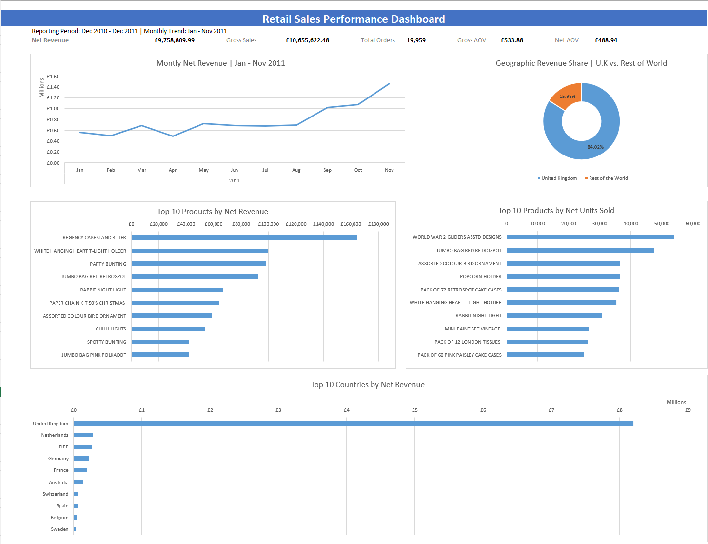

# Retail Sales Analysis

Excel-based analysis of 541,909 retail transactions to evaluate revenue performance, product demand, seasonal trends, and geographic sales distribution.

## Project Overview

Analyzed the UCI Online Retail dataset using Power Query, Excel formulas, and PivotTables. Built a dashboard to visualize key performance indicators (KPIs) and identify actionable business insights.

**Tools & Skills:** Microsoft Excel, Power Query, PivotTables, SUMIF, FILTER, UNIQUE, data cleaning, data visualization, and business analysis.

## Data Cleaning

- Identified missing CustomerIDs, negative quantities, and invalid-price records.
- Excluded 2,518 zero-price and accounting-adjustment records.
- Retained negative quantities to account for returns and cancellations.
- Created a calculated Revenue column using Quantity × UnitPrice.
- Preserved original data and documented cleaning decisions.

**Final dataset:** 539,391 transaction lines.

## Key Performance Indicators

| Metric | Value |
|---|---:|
| Net Revenue | £9,758,809.99 |
| Gross Sales | £10,655,622.48 |
| Revenue Reduction Rate | 8.42% |
| Purchase Orders | 19,959 |
| Gross Average Order Value | £533.88 |
| Net Average Order Value | £488.94 |

## Key Findings

- **Geographic Concentration:** The UK generated 84.02% of total net revenue, highlighting an opportunity to diversify international sales.
- **Seasonal Demand:** Revenue peaked at £1.46M in November 2011, suggesting the need for earlier inventory planning.
- **Product Performance:** REGENCY CAKESTAND 3 TIER led in net revenue (£164,762), while WORLD WAR 2 GLIDERS led in net units sold (53,847).
- **Returns & Cancellations:** Negative-revenue transactions offset approximately £897K, or 8.42% of gross sales.

## Dashboard Preview

The dashboard includes monthly revenue trends, product rankings, geographic revenue distribution, and key financial metrics.

## Excel Workbook

**[View or Download the Full Excel Workbook](https://docs.google.com/spreadsheets/d/1-jkRqKl1ZmRgmaHD7eYyKJT4d5mRF5cY/edit?usp=drive_link&ouid=103443194306428916089&rtpof=true&sd=true)**

The workbook includes Raw Data, Data Quality, Cleaned Data, Analysis, Dashboard, and Insights worksheets.

## Limitations

- COGS data is unavailable, preventing profitability analysis.
- Revenue reduction from returns is not equivalent to an order return rate.
- December 2011 is incomplete and excluded from the monthly trend chart.
- Merchandise rankings exclude identified postage charges.

## Data Source

[UCI Online Retail Dataset](https://archive.ics.uci.edu/dataset/352/online+retail)
